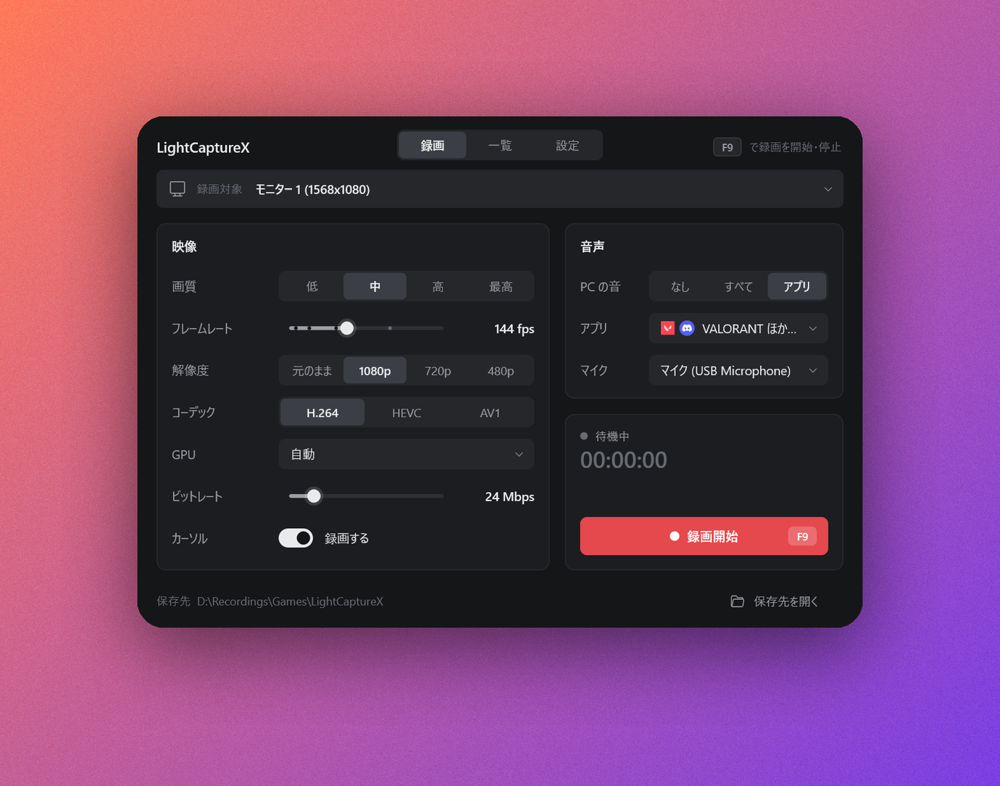
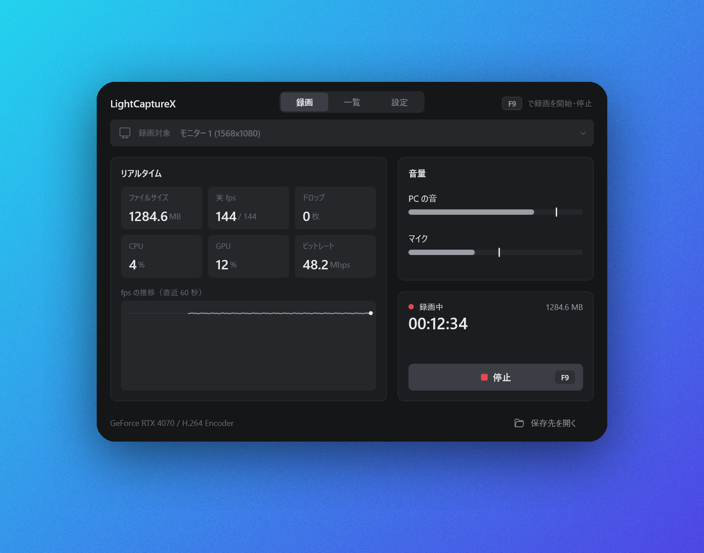
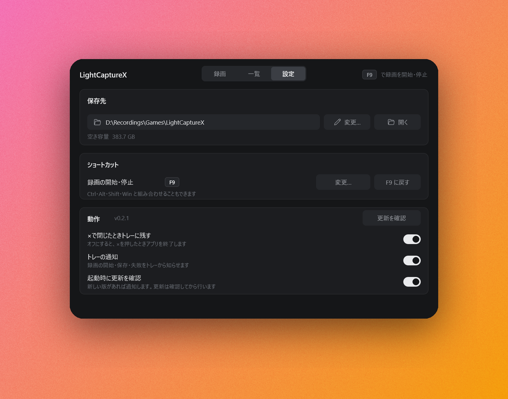

<div align="center">

# LightCaptureX

Windows 用の超軽量なゲーム録画ソフト。

[](https://github.com/Lapius7/lightcapturex/releases/latest)
[](LICENSE)


[English](README.md) · **日本語**



 

</div>

約 0.7 MB の exe ひとつで動き、ランタイムのインストールはいりません。

画面の取り込み、色の変換、縮小、エンコードをすべて GPU で行うので、CPU はほとんど使いません。VALORANT のように CPU が重いゲームの録画に向いています。

## 機能

- モニター全体か、ウィンドウひとつを録画（Windows.Graphics.Capture）
- ハードウェアエンコード: H.264 / HEVC / AV1（Media Foundation 経由で NVENC、Quick Sync、AMF）
- GPU の選択: 自動（録画するモニターを担当する GPU）か手動。選んだ GPU でエンコードできないときは、ほかの GPU に切り替える
- 画質（4 段階）、フレームレート 15〜360 fps（スライダー）、出力解像度（元のまま / 1080p / 720p / 480p）
- 音声は 1 本のトラックにまとめて録音
  - PC の音: 録音しない / すべての音 / **選んだアプリだけ**（VALORANT と Discord だけ、など）
  - マイク
- ショートカットで録画の開始と停止（既定は **F9**。ほかのアプリを操作中でも使えて、設定タブで変えられます）
- 録画中のリアルタイム表示: 経過時間、ファイルサイズ、実測 fps、ドロップ数、音量メーター、CPU/GPU 使用率
- 録画一覧タブ: 再生、フォルダーで表示、削除
- 保存先フォルダーと目標ビットレート（自動、または 1〜150 Mbps（スライダー））の変更
- 録画対象を選ぶときに、それぞれの今の画面をプレビュー表示。録画一覧にはサムネイルを表示
- 自動アップデート: 起動時に GitHub のリリースを確認し、「更新する」を押すと exe をその場で入れ替えます
- タスクトレイ: ×で閉じるとトレイに入り、録画中はアイコンが赤く点滅します。メニューから録画の開始と停止、最近の録画、主な設定を操作でき、通知も出せます
- 設定は自動で保存

## 動作環境

- Windows 10 2004 以降（アプリごとの音声の録音に 2004 以降が必要。Windows 11 を推奨）
- 動画のハードウェアエンコーダを持つ GPU

## ダウンロード

[最新のリリース](https://github.com/Lapius7/lightcapturex/releases/latest)から、次のどちらかを入れます。

- `lightcapturex-installer-vX.Y.Z.exe`: インストーラーです。ユーザーごとにインストールするので管理者権限はいりません。スタートメニューのショートカット（デスクトップは任意）と、Windows の設定に表示されるアンインストール項目が加わります。
- `lightcapturex.exe`: アプリ本体だけです。そのまま起動できます。

どちらでも、更新はアプリ自身が確認します。

## 使い方

1. `lightcapturex.exe` を起動します。
2. 録画対象、画質、エンコード（コーデックと GPU）、マイク、PC の音を選びます。
3. ショートカット（既定は **F9**。または録画ボタン）を押すと録画が始まり、もう一度押すと止まります。

録画したファイルは `ビデオ\LightCaptureX\LightCaptureX_YYYYMMDD_HHMMSS.mp4` に保存されます。

### 一部のアプリの音だけを録る

「PC の音」を「アプリ」にして、「アプリ」の行を押すと、アプリの一覧が開きます。一覧には起動中のアプリがアイコンつきで並び、いま音を出しているアプリには「再生中」と出ます。VALORANT と Discord は起動していなくても一覧に出ます。録音したいアプリにチェックを入れてください。録画を始めたあとに起動したアプリの音も、自動で録音に加わります。

### ヒント

- 排他フルスクリーンのゲームをウィンドウで録画して黒い画面になるときは、モニターを録画するか、ゲームをボーダーレスにしてください。
- ショートカットがほかのアプリに使われているときは、画面の右上にそう表示されます。

## コマンドライン（動作確認用）

```
lightcapturex --list
lightcapturex --source 0 --seconds 10 --out C:\tmp\a.mp4 [--fps 60] [--quality 0-3] [--height 1080]
              [--codec h264|hevc|av1] [--gpu "<名前>"] [--mic N] [--no-sys] [--apps a.exe,b.exe]
```

## ビルド

Linux や WSL から、MinGW でクロスコンパイルします。

```
rustup target add x86_64-pc-windows-gnu
sudo apt install gcc-mingw-w64-x86-64
cargo build --release
```

`target/x86_64-pc-windows-gnu/release/lightcapturex.exe` ができます。

インストーラーは [Inno Setup 6](https://jrsoftware.org/isinfo.php) で作ります。先にアプリをビルドしてから実行します。

```
ISCC.exe /DAppVersion=X.Y.Z installer/lightcapturex.iss
```

`installer/Output/lightcapturex-installer-vX.Y.Z.exe` ができます。

## ライセンス

MIT © Lapius7
