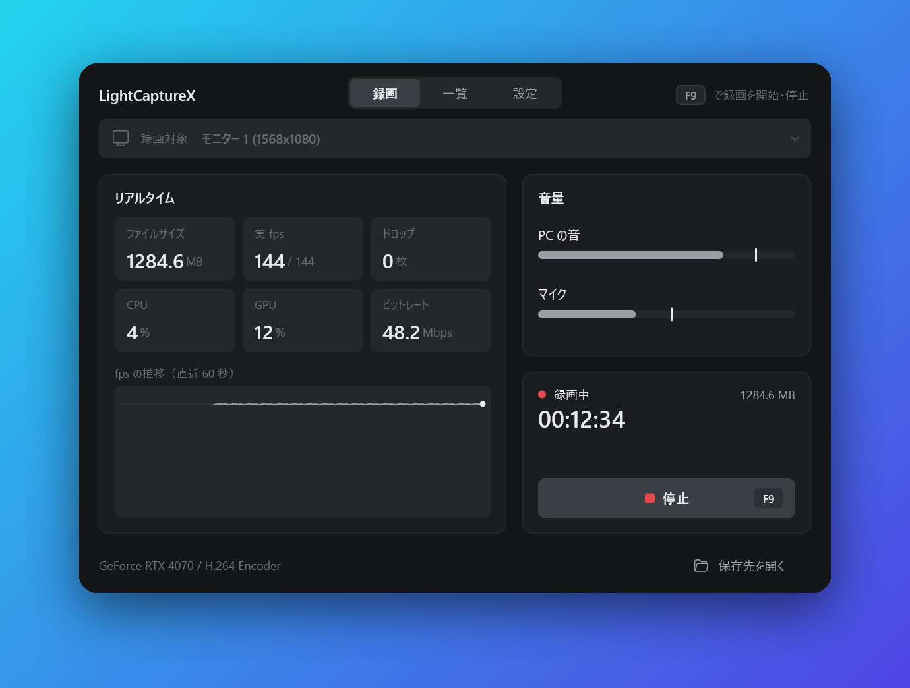
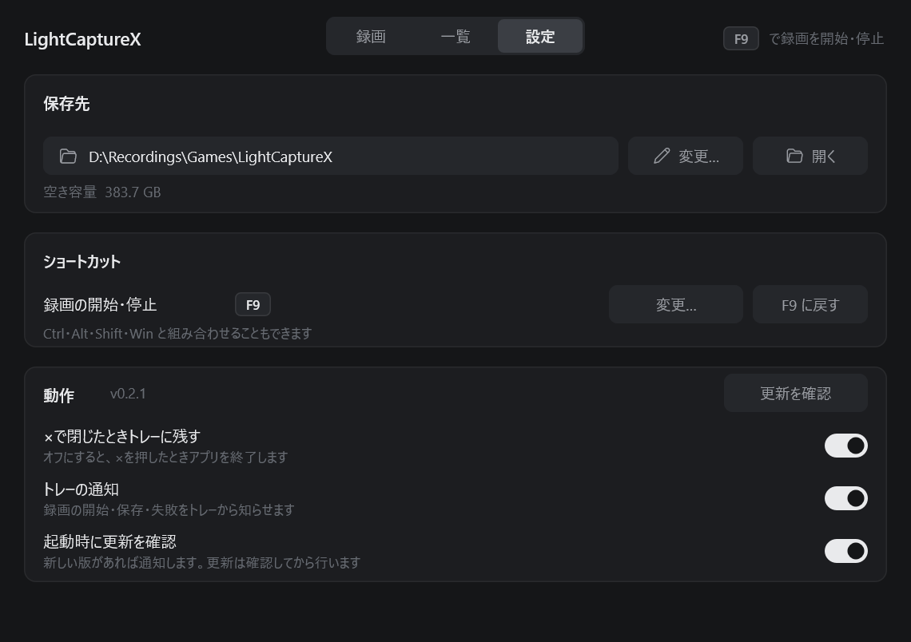

<div align="center">

<p align="center"><b>English</b> | <a href="README.ja.md">日本語</a></p>

<h1 align="center">LightCaptureX</h1>

<h3 align="center">An ultra-lightweight game recorder for Windows.</h3>

<p align="center">A single ~0.7 MB executable with no runtime dependencies. Capture, color conversion, scaling and encoding all run on the GPU, so it barely touches the CPU. That helps with CPU-bound games such as VALORANT.</p>

<p align="center">
  <a href="https://github.com/Lapius7/lightcapturex/releases/latest"></a>
  
  <a href="https://www.rust-lang.org"></a>
  <a href="LICENSE"></a>
  <a href="https://github.com/Lapius7/lightcapturex/stargazers"></a>
  <a href="https://github.com/Lapius7/lightcapturex/commits/main"></a>
</p>

<p align="center">
  <a href="#features">Features</a> ·
  <a href="#download">Download</a> ·
  <a href="#usage">Usage</a> ·
  <a href="#build">Build</a>
</p>

<p align="center">
  
  
</p>

</div>

---

## Features

- Record a monitor or a single window (Windows.Graphics.Capture)
- Hardware encoding: H.264 / HEVC / AV1 (NVENC, Quick Sync, AMF via Media Foundation)
- GPU selection: automatic (the GPU driving the captured monitor) or manual; falls back to another GPU if the chosen one can't encode
- Quality (4 levels), frame rate 15–360 fps (slider), output resolution (source / 1080p / 720p / 480p)
- Audio mixed into one track:
  - PC sound: off / everything / **selected apps only** (e.g. only VALORANT + Discord)
  - Microphone
- **Replay buffer**: keeps the last few seconds (5–300) in the background, even when not recording, and saves them when you press a hotkey (default **F10**). Replays can go to their own folder, and it works while recording too
- Global hotkey to start/stop (default **F9**, changeable in the settings tab)
- Live stats while recording: elapsed time, file size, real fps, dropped frames, audio level meters, CPU/GPU usage
- Recordings tab: list, play, show in folder, delete
- Changeable save folder and target bitrate (auto or 500–150,000 kbps (slider or type a value))
- Live preview of each capture target in the picker; thumbnails in the recordings list
- Auto update: checks GitHub Releases at startup and replaces the exe in place when you click Update
- Tray icon: closing the window hides it to the tray; the icon blinks red while recording; menu for start/stop, recent recordings and quick settings; optional notifications
- Settings are saved automatically

## Requirements

- Windows 10 2004 or later (per-app audio requires 2004+; Windows 11 recommended)
- A GPU with a hardware video encoder

## Download

From the [latest release](https://github.com/Lapius7/lightcapturex/releases/latest), get either of these:

- `lightcapturex-installer-vX.Y.Z.exe`: installer. Installs per user (no admin rights needed), with a Start menu shortcut, an optional desktop shortcut, and an uninstall entry in Windows Settings.
- `lightcapturex.exe`: the app alone. Just run it.

Either way, the app checks for updates by itself.

## Usage

1. Run `lightcapturex.exe`.
2. Choose what to record, quality, codec/GPU, microphone and PC sound.
3. Press the hotkey (default **F9**, or the record button) to start, and press it again to stop.

Recordings are saved to `Videos\LightCaptureX\LightCaptureX_YYYYMMDD_HHMMSS.mp4` by default (changeable in the settings tab).

### Recording only some apps' sound

Set "PC の音" (PC sound) to "アプリ" (apps), then click the "アプリ" row to open the app list. It shows running apps with their icons and marks the ones playing sound right now; VALORANT and Discord are listed even when they aren't running. Check the apps to record. Apps launched after recording starts are picked up automatically.

### Replay buffer

Turn on "リプレイバッファ" (replay buffer) in the settings tab and pick the length with "長さ". While it's on, the app keeps capturing the screen and sound, even when you aren't recording, and keeps the most recent part in a temp folder. Press the replay hotkey (default **F10**) or the "保存" (save) button in the record tab to save it to `Videos\LightCaptureX\Replays\LightCaptureX_Replay_YYYYMMDD_HHMMSS.mp4`. You can change the folder in the settings tab. The buffered video is deleted when the app exits.

Replays use the record tab's settings (source, quality, audio, and so on). Capturing and encoding keep running while the buffer is on, so it uses some GPU even when you aren't recording.

### Tips

- If a game in exclusive fullscreen records as black, record the monitor instead of the window, or use borderless mode.
- If the hotkey is taken by another app, the top right of the window says so.

## Command line (for testing)

```
lightcapturex --list
lightcapturex --source 0 --seconds 10 --out C:\tmp\a.mp4 [--fps 60] [--quality 0-3] [--height 1080]
              [--codec h264|hevc|av1] [--gpu "<name>"] [--mic N] [--no-sys] [--apps a.exe,b.exe]
```

## Build

Cross-compiled from Linux/WSL with the MinGW toolchain:

```
rustup target add x86_64-pc-windows-gnu
sudo apt install gcc-mingw-w64-x86-64
cargo build --release
```

The output is `target/x86_64-pc-windows-gnu/release/lightcapturex.exe`.

To build the installer, install [Inno Setup 6](https://jrsoftware.org/isinfo.php) and build the app first:

```
ISCC.exe /DAppVersion=X.Y.Z installer/lightcapturex.iss
```

The output is `installer/Output/lightcapturex-installer-vX.Y.Z.exe`.

## License

MIT © Lapius7
